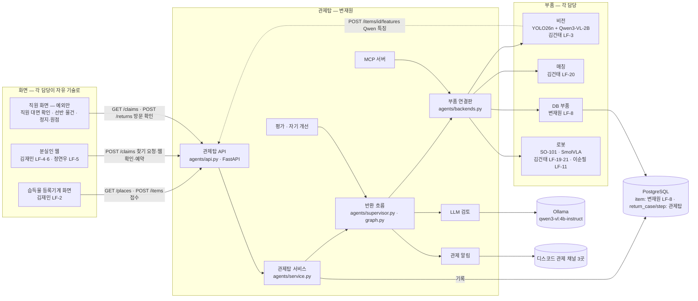
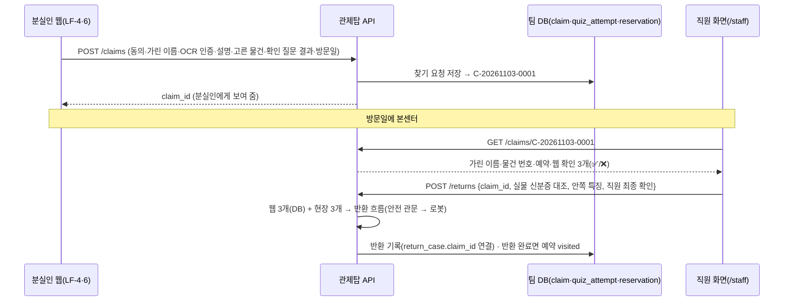

# 전체 구조도 — AI 분실물 관제탑

> 결정(11/3, 변재원): **전체 구조는 관제탑(변재원)이 정하고, 팀원이 만든 모델·화면·DB·로봇 동작은 이 구조에 부품으로 연결한다.**
> 화면들은 **관제탑 API(FastAPI)** 를 HTTP로 부른다. 반환 기록 표(return_case·return_step)는 **관제탑 소유**로 같은 PostgreSQL에 둔다.

## 1. 한 장 구조

- 등록기계 접수(사진 → 특징 JSON → item 표 저장)는 반환 흐름이 아니라 DB 부품 쪽 흐름이다. 관제탑은 반환할 때 `db_get_item` 으로 읽기만 한다
- 웹 안내 챗봇(RAG)·통계 질문(Text2SQL)은 관제탑을 거치지 않는다(정연우 LF-5·9)

## 2. 어느 PC에서 무엇이 도나 (시연 기준)
| PC | 돌아가는 것 | 비고 |
| --- | --- | --- |
| 시연 PC(교육원, RTX 3050 6GB) | 관제탑 API(포트 8100) · 반환 흐름 · Ollama · 비전 추론 · 로봇(SO-101) · 탑뷰 카메라 · PostgreSQL · 2조봇 세션 | GPU: Qwen3-VL과 SmolVLA를 동시에 올리지 않음(mcp_tools.md 5장) |
| 등록기계(시연 PC 또는 노트북 + 웹캠·터치 화면) | 등록기계 화면 → DB 부품 | 같은 네트워크 |
| 분실인·직원 | 브라우저로 웹 화면 접속 → 웹 서버가 관제탑 API 호출 | 외부 공개 TBD(교육원 안에서만) |
| 학습 PC(RTX 4070 SUPER) | YOLO·SmolVLA 학습 → Hugging Face 비공개 저장소 | 시연 때는 안 씀 |

## 3. 관제탑 API (FastAPI, agents/api.py)
| 경로 | 하는 일 | 성공 | 실패 |
| --- | --- | --- | --- |
| `GET /health` | 살아 있음 · 부품 진짜/가짜 · 실행 중 여부 | 200 | — |
| `GET /tools` | 도구 목록(담당·실패 규칙) | 200 | — |
| `GET /places?machine_id=` | 등록기계: 그 역의 추천 습득 장소(많이 고른 순) | 200 + [{place_id, label}] | 422 모르는 기계 · 503 DB |
| `POST /items` | 등록기계: 습득물 접수(장소 필수, 연락처 선택, 사진 위치) → 접수 번호. 연락처는 응답에 안 나옴 | 200 + item_id·received_at·contact_saved | 422 형식(장소 비움·전화 형식·받지 않는 칸) · 503 DB |
| `POST /items/{item_id}/features` | 뒤에서 도는 Qwen 작업: 특징 저장(공개·비공개 나눔) | 200 + category·공개 특징 | 404 없는 접수 번호 · 422 형식 · 503 DB |
| `POST /claims` | 웹: 찾기 요청 저장(웹 확인 3개 + 수령 예약) | 200 + claim_id·web_gates | 422 형식·개인정보 원문·없는 물건 · 503 DB |
| `GET /claims/{claim_id}` | 직원 화면: 찾기 요청 조회(가린 이름·물건·예약·웹 확인) | 200 | 404 없음 · 422 번호 형식 |
| `GET /staff` | 직원 화면(본센터 방문 확인) 페이지 | 200 | — |
| `POST /returns` | 반환 흐름 실행 | 200 + 결과(decision·reason·approved·steps…·recorded) | 422 형식 오류 · 404 없는 찾기 번호 · 409 같은 사례 번호·이미 방문 처리(duplicate) 또는 다른 반환 진행 중(busy) · 503 DB 연결 안 됨 |
| `POST /api/kiosk/handover` | 11/11 무인 인계: 분실인이 제출보관함에서 꺼낸 뒤 본센터 키오스크 [물건 받았어요] → `인계 대기` → `인계 완료`(`changed_by=kiosk`). 본문 `{"machine_id": "CENTER", "claim_id", "id_no_masked"}`(회수와 같은 본인 확인, 3번 틀리면 잠금) | 200 + item_id·status·by | 422 번호 틀림 · 404 없는 찾기 번호 · 409 이미 인계(duplicate)·인계 대기 아님(state)·예외는 직원(staff) |
| `POST /returns/{case_id}/handover` | (11/11부터 예외만) 직원 화면: 바구니의 물건을 분실인에게 건넴 → `인계 대기` → `인계 완료` (11/4). 본문 `{"staff_confirmed": true}` | 200 + item_id·status | 404 없는 사례 · 409 이미 인계(duplicate)·인계할 상태 아님(state) · 422 본문 · 503 DB |
| `POST /returns/{case_id}/hold` | 직원 화면: 인계 대기 중 건네지 않음 → `반환 보류` + 경보. 본문 `{"reason": "본인 아님"|"물건 다름"|"분실인 거부"|"기타"}` (자유 입력 없음) | 200 + item_id·status·reason | 404 · 409 이미 보류(duplicate)·인계 대기 아님(state) · 422 · 503 |
| `GET /returns` | 최근 기록(단계 제외) | 200 | — |
| `GET /returns/{case_id}` | 기록 하나(단계 포함) | 200 | 404 없음 · 422 번호 형식 |

## 3-1. 켜 두기 (시연 PC)
| 무엇 | 켜는 법 | 계속 켜져 있나 |
| --- | --- | --- |
| 팀 DB(PostgreSQL 16 + pgvector) | `docker compose up -d` (저장소 폴더) | 예 — `restart: unless-stopped`. Docker Desktop 설정의 "로그인할 때 시작"이 켜져 있으면 재부팅 뒤에도 자동 |
| 관제탑 API | `tools\start_tower.bat` 더블클릭(Docker 준비 대기 → DB 켜기 → API 실행) | 창이 열려 있는 동안. 교육원 PC는 11/6 부터 시작 프로그램 자동 실행을 끄고 Warp 실행 구성(AgentOps 2조, 관제탑 탭 `start_tower.bat dev`)으로 켠다(두 번 켜져 8100 포트가 겹치는 문제 때문). **창 안을 클릭하지 않기**(Windows '선택' 모드가 되면 API 가 멈춤 → Esc 로 풀기) |
| 2조봇 | 봇 터미널에서 claude 세션 | 터미널이 열려 있는 동안(Claude 사용량은 디스코드로 부를 때만) |
- 알림: `.env` 에 `TOWER_SEND=1` 이면 단계별 알림은 관제 채널, 반환 1건당 결과 한 줄은 팀 채팅(`DISCORD_WEBHOOK_TEAM`, 부산7기 #2조-분실물관리시스템)으로 간다
- API 모드: 기본은 가짜 부품·메모리 기록. `.env` 에 `TOWER_DB=1` + `DATABASE_URL` 이면 물건 기록·상태·반환 기록이 팀 DB로 간다(비전·매칭·로봇은 아직 가짜)
- DB가 꺼져 있으면 API는 **503** 을 돌려주고 로봇을 움직이지 않는다(중복 실행 확인을 못 하므로). 반환이 끝난 뒤 기록만 실패하면 결과는 돌려주고 `recorded: false` + 관제 알림

## 3-2. 웹 ↔ 관제탑 2단계 연결 (11/3 결정)
> 11/11: 아래 그림은 직원 화면으로 반환을 시작하는 길(예외·키오스크를 못 쓸 때)이다. 정상 흐름은 본센터 키오스크 `POST /api/kiosk/returns`(현장 관문은 서버가 정함) → 제출보관함 → 키오스크 `POST /api/kiosk/handover` 로 끝나 직원이 끼지 않는다.

확인 6개 중 3개는 집에서 웹으로, 3개는 본센터 방문 때 생긴다 → 두 번에 나눠 보내고, **웹 결과는 저장된 값만** 쓴다(직원이 다시 입력하지 않음).

웹 → `POST /claims` 본문 (이름·신분증 번호는 **가린 값**만, 설명 칸은 database.md 6장)
```json
{"consent": true, "name_masked": "변*원", "id_no_masked": "******-3******", "id_verified": true,
 "description": {"category": "지갑", "color": "검정", "mark": "별 모양 스티커"},
 "item_id": "A-20261103-0001", "quiz": [{"field": "mark", "passed": true}],
 "visit_date": "2026-11-04", "lost_station": "중앙", "lost_date": "2026-11-02"}
```
직원 화면 → `POST /returns` 본문(2단계)
```json
{"claim_id": "C-20261103-0001", "visitor_id_match": true, "inner_feature_ok": true, "staff_confirmed": true}
```
- 사례 번호는 `R-찾기번호`(다시 시도하면 직원 화면이 `-2` 를 붙임). 반환 완료된 찾기 요청은 다시 실행되지 않는다
- 직원 화면은 웹 관문 칸을 보낼 수 없다(보내면 422) → 웹에서 확인 질문을 틀렸으면 직원이 바꿀 수 없음
- 시연·시험용 1단계 본문(`case_id`, `item_id` + 관문 6개)도 그대로 받는다
- 직원 화면 열기: 관제탑이 켜진 PC에서 http://127.0.0.1:8100/staff (시연용 찾기 요청 만들기 포함)
- 같은 `case_id` 로는 다시 실행되지 않는다(로봇 두 번 동작 방지). 로봇이 1대라 동시에 하나만 실행
- 부품이 약속을 어기고 예외를 던지면: 로봇 정지 시도 → 결정 `stopped` → 알림 → 기록
- 실행: `python -m uvicorn agents.api:app --host 127.0.0.1 --port 8100` → http://127.0.0.1:8100/docs

## 3-3. 매칭 방식 — 사람 말 ↔ Qwen 결과 (11/3 결정: 김건태·변재원)
매칭은 두 군데다. 사람 말이 끼는 곳은 ① 하나다.
| 매칭 | 비교 | 방법 |
| --- | --- | --- |
| ① 웹 후보 찾기(LF-6·20) | 분실인 말(한국어) ↔ 접수 DB 특징(Qwen, 영어) | **칸별 코드 점수 + 텍스트 임베딩 점수** |
| ② 반환 때 보관함에서 찾기(LF-20, 관제탑 `match_item`) | 접수 DB 특징 ↔ 탑뷰 특징(둘 다 Qwen) | 칸별 코드 점수(같은 모델·같은 언어) |

①의 점수 = 칸별 점수 + 임베딩 점수
1. **칸별 코드 점수**: 품목·색·모양·재질·표시를 정해진 영어 코드 목록으로 맞춘 뒤 비교. 완전히 같을 때만 1점이 아니라 **가까움 점수**
   - 색 예: red↔red 1.0 · red↔orange 0.6 · red↔pink 0.5 · red↔brown 0.3 · red↔blue 0 (숫자는 시험 사례로 조정, 처음 값은 추정)
   - 애매한 말("붉은 주황")은 코드를 여러 개 `[red, orange]` 로 두고 하나라도 맞으면 점수. "모르겠다"는 비교에서 뺀다(틀린 것으로 치지 않음)
   - 화면에는 코드 대신 한국어 이름표(black → 검정)
2. **텍스트 임베딩 점수**: 다국어 문장 임베딩으로 분실인 문장(한국어)과 물건 특징 문장(영어)을 번역 없이 바로 비교 → 코드 목록에 없는 특징("모서리 볼펜 자국")까지 잡는다
   - 물건 쪽 임베딩은 **등록할 때 한 번** 계산해 저장, 검색 때는 분실인 문장 1개만 계산 → 검색 1번 수십 ms(추정, `tools/bench_embedding.py` 로 PC 실측)
   - **CPU 에서 돌린다**(아래 GPU 순서에 끼지 않음). 모델 후보: multilingual-e5-small 계열(가벼움)·bge-m3 계열(정확) — 실측 뒤 결정, 차원·DB 칸은 그때 확정
3. 한 칸(색)이 조금 달라도 탈락시키지 않고 **합친 점수 순위로 후보 3개**. 뒤에서 분실인 선택·확인 질문·신분증 대조·직원 확인이 다시 거른다
- 이미지 임베딩(CLIP 계열, schema_vector.sql)은 계속 보류 — 위의 텍스트 임베딩과 다르다

## 3-4. GPU 사용 순서 (RTX 3050 6GB, 한 번에 하나)
VLA(로봇 동작 모델)를 돌리려면 Qwen 을 내려야 한다 → **Qwen 은 상주시키지 않는다**(쓸 때 켜고 끝나면 내림, 모델 읽기 약 8초는 매번 든다)
```
STT 입력 확정 → STT 해제 → 보관함 촬영 → Qwen 분석(GPU) → Qwen 해제 → 관제탑: 결과 읽기·매칭(CPU) → VLA 로봇 동작(GPU)
```
- 11/4 김건태 순서안. 모듈이 따로 실행되므로 **GPU 사용권**(`agents/gpu_lease.py`, [gpu_lease.md](gpu_lease.md))으로 순서를 지킨다: 각 모듈은 GPU 를 쓰기 전에 열쇠를 받고 모델을 내린 뒤 돌려준다. 관제탑은 사전 접근 전에 `vla` 열쇠를 받고, 못 받으면(대기 60초 초과) 로봇을 움직이지 않고 직원 확인
- 관제탑 비전 부품은 반환 중에 Qwen 을 다시 켜지 않고 **미리 만든 결과 파일만** 읽는다(`agents/vision_adapter.py`, 기본 600초 넘은 결과는 안 씀 → 직원 확인). 결과에 촬영 시각 `captured_at` 이 있으면 그 기준(11/4), 유효 초는 김건태 님이 실측 뒤 정함
- 텍스트 임베딩·매칭·DB·관제탑 API 는 CPU
- Qwen 지연 개선은 상주 worker 대신 프롬프트·출력 길이·해상도 줄이기(이순필 qwen-latency-review 3~5번)로
- ~~VLA 켜기·끄기 방식이 정해지면 "Qwen 실행 중이면 기다리거나 직원 확인" 확인을 흐름에 넣는다(TBD)~~ → 11/4 GPU 사용권으로 반영. 모듈 쪽에 열쇠 받기 넣기는 각 담당(STT·Qwen 김건태, VLA 김건태·이순필)

## 4. 데이터 소유
| 표 | 소유 | 관제탑이 하는 일 |
| --- | --- | --- |
| item(물건·특징 JSON·상태) 외 접수·회수·찾기 표 | 변재원 LF-8 (설계·확정 11/3, database.md) | 읽기(`db_get_item`) · 상태 변경(`db_set_status`) |
| return_case · return_step | 관제탑(center/schema.sql 반환 묶음) | 반환이 끝날 때마다 저장(지금은 메모리, DB 연결 때 PostgresRecorder) |
| 개선 회차(EVAL_RUN, 제안) | 관제탑 | 지금은 #📈평가-점수 글로만 |

## 5. 연결 순서 (선행 관계)
1. 관제탑 API·흐름·기록(가짜 부품) — **완료(11/3)**
2. DB 초안 v1(center/schema.sql) · docker compose · DB 부품(agents/db_part.py) · PostgresRecorder — **완료·확정(11/3)**, 확정 사항은 database.md 6장
3. 비전(LF-3) → 매칭(LF-20) 연결 → 탑뷰 실측으로 매칭 가중치 조정
4. 웹(LF-4·6)이 `POST /claims` 호출 — 관제탑 쪽(API·직원 화면 `/staff`) **준비 완료(11/3)**, 웹 연결 대기
5. 로봇(LF-21 → LF-19, LF-11) 연결 → 통합 시연(LF-18)
