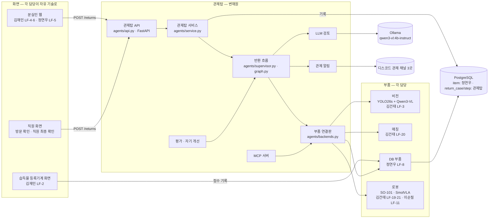

# 전체 구조도 — AI 분실물 관제탑

> 결정(11/3, 변재원): **전체 구조는 관제탑(변재원)이 정하고, 팀원이 만든 모델·화면·DB·로봇 동작은 이 구조에 부품으로 연결한다.**
> 화면들은 **관제탑 API(FastAPI)** 를 HTTP로 부른다. 반환 기록 표(return_case·return_step)는 **관제탑 소유**로 같은 PostgreSQL에 둔다.

## 1. 한 장 구조

- 등록기계 접수(사진 → 특징 JSON → item 표 저장)는 반환 흐름이 아니라 DB 부품 쪽 흐름이다. 관제탑은 반환할 때 `db_get_item` 으로 읽기만 한다
- 웹 안내 챗봇(RAG)·통계 질문(Text2SQL)은 관제탑을 거치지 않는다(정연우 LF-5·9)

## 2. 어느 PC에서 무엇이 도나 (시연 기준)
| PC | 돌아가는 것 | 비고 |
| --- | --- | --- |
| 시연 PC(교육원, RTX 3050 6GB) | 관제탑 API(포트 8100) · 반환 흐름 · Ollama · 비전 추론 · 로봇(SO-101) · 탑뷰 카메라 · PostgreSQL · 2조봇 세션 | GPU: Qwen3-VL과 SmolVLA를 동시에 올리지 않음(mcp_tools.md 5장) |
| 등록기계(시연 PC 또는 노트북 + 웹캠·터치 화면) | 등록기계 화면 → DB 부품 | 같은 네트워크 |
| 분실인·직원 | 브라우저로 웹 화면 접속 → 웹 서버가 관제탑 API 호출 | 외부 공개 TBD(교육원 안에서만) |
| 학습 PC(RTX 4070 SUPER) | YOLO·SmolVLA 학습 → Hugging Face 비공개 저장소 | 시연 때는 안 씀 |

## 3. 관제탑 API (FastAPI, agents/api.py)
| 경로 | 하는 일 | 성공 | 실패 |
| --- | --- | --- | --- |
| `GET /health` | 살아 있음 · 부품 진짜/가짜 · 실행 중 여부 | 200 | — |
| `GET /tools` | 도구 목록(담당·실패 규칙) | 200 | — |
| `POST /returns` | 반환 흐름 실행 | 200 + 결과(decision·reason·approved·steps…) | 422 형식 오류 · 409 같은 사례 번호(duplicate) 또는 다른 반환 진행 중(busy) |
| `GET /returns` | 최근 기록(단계 제외) | 200 | — |
| `GET /returns/{case_id}` | 기록 하나(단계 포함) | 200 | 404 없음 · 422 번호 형식 |

`POST /returns` 본문 (개인정보 없이 관문 결과만)
```json
{"case_id": "R-20261103-001", "item_id": "A-W01",
 "consent": true, "id_verified": true, "quiz_passed": true,
 "visitor_id_match": true, "inner_feature_ok": true, "staff_confirmed": true}
```
- 웹은 동의·인증·확인 질문 결과를, 직원 화면은 신분증 대조·안쪽 특징·직원 확인 결과를 채운다(누가 어느 칸을 채울지는 LF-6·12와 맞춤)
- 같은 `case_id` 로는 다시 실행되지 않는다(로봇 두 번 동작 방지). 로봇이 1대라 동시에 하나만 실행
- 부품이 약속을 어기고 예외를 던지면: 로봇 정지 시도 → 결정 `stopped` → 알림 → 기록
- 실행: `python -m uvicorn agents.api:app --host 127.0.0.1 --port 8100` → http://127.0.0.1:8100/docs

## 4. 데이터 소유
| 표 | 소유 | 관제탑이 하는 일 |
| --- | --- | --- |
| item(물건·특징 JSON·상태) 외 접수·회수·찾기 표 | 정연우 LF-8 (초안 설계: 변재원, database.md) | 읽기(`db_get_item`) · 상태 변경(`db_set_status`) |
| return_case · return_step | 관제탑(center/schema.sql 반환 묶음) | 반환이 끝날 때마다 저장(지금은 메모리, DB 연결 때 PostgresRecorder) |
| 개선 회차(EVAL_RUN, 제안) | 관제탑 | 지금은 #📈평가-점수 글로만 |

## 5. 연결 순서 (선행 관계)
1. 관제탑 API·흐름·기록(가짜 부품) — **완료(11/3)**
2. DB 초안 v1(center/schema.sql, 11/3) → 정연우 검토 → DB 부품(LF-8)·PostgresRecorder 연결
3. 비전(LF-3) → 매칭(LF-20) 연결 → 탑뷰 실측으로 매칭 가중치 조정
4. 웹(LF-6)이 `POST /returns` 호출
5. 로봇(LF-21 → LF-19, LF-11) 연결 → 통합 시연(LF-18)
