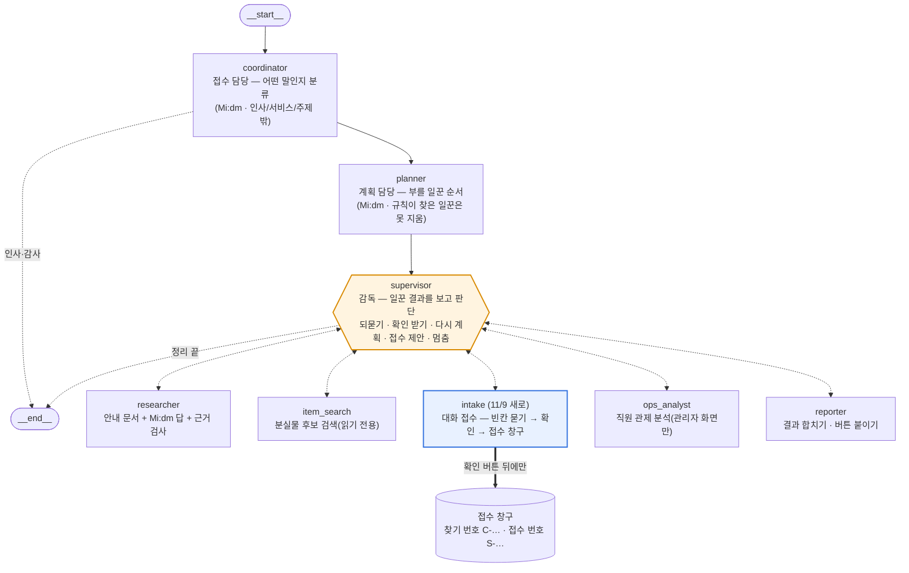

# 챗봇 에이전트 구조 — 질문 하나가 안에서 어떻게 처리되나 (LF-5 · 11/9 변재원)

한줄 설명: **DeerFlow(LangManus) 모양 그대로** — coordinator(분류) → planner(계획) → supervisor(감독) ⇄ 일꾼들 → 끝.
11/9부터 일꾼 **intake(대화 접수)**가 생겨 챗봇으로 **분실 접수·습득 신고를 끝까지** 하고,
**supervisor 가 일꾼 결과를 보고 다음 행동을 판단**한다(되묻기 · 확인 받기 · 다시 계획 · 접수 제안 · 멈춤). 판단 근거는 Langfuse 에 남는다.

- 코드: 그래프 `agents/chatbot.py` · 대화 접수 `agents/chat_intake.py` · 분류·계획·빈칸 채우기 모델 `agents/chat_agents.py` · 안내 답 `agents/chat_rag.py` · 물건 검색 `agents/chat_search.py`
- 화면: `web/chat-widget/widget.js`(버튼·본인 확인 입력칸·투명도 조절바)
- 시험: `tests/test_chat_intake.py`(접수·감독 판단 15개), `tests/test_deerflow_langfuse.py`(그래프·기록)


(GitHub 에서 그림으로 보임. 저장소 규칙상 PNG 는 올리지 않음)

---

## 1. 교수님 지시(11/7)와 지금 구조 맞춰 보기
교수님 그림: `__start__ → coordinator → planner → supervisor ⇄ researcher · coder · browser · reporter → __end__`

| 교수님 그림 | 우리 챗봇 | 하는 일 | 모델 사용 |
|---|---|---|---|
| coordinator | coordinator | 들어온 말을 분류: 인사·감사(바로 끝) / 서비스 질문 / 주제 밖 / **접수 대화 중** | Mi:dm(값 4개 중 하나만 고르게 JSON 고정) |
| planner | planner | 부를 일꾼과 순서를 정함 | Mi:dm(일꾼 이름 목록 안에서만) |
| supervisor | **supervisor(판단하는 감독)** | 일꾼이 끝날 때마다 결과를 보고 다음 행동을 정함(3장) | 판단은 규칙(코드) — 이유를 기록 |
| researcher | researcher | 안내 문서를 찾고 Mi:dm 이 답을 씀 → 문장마다 근거 검사 | Mi:dm |
| browser(찾아보기) | item_search | 분실물 후보를 DB 에서 찾음(읽기 전용) | 없음 |
| coder(무언가를 실행) | **intake(대화 접수)** | 빈칸을 하나씩 묻고 → 요약 확인 → **접수 창구를 실제로 호출** | Mi:dm(규칙이 못 읽은 품목·색만) |
| (추가) | ops_analyst | 직원 관제 질문(관리자 화면만) — 안에 또 하나의 LangManus 구조 | 있음 |
| reporter | reporter | 일꾼 결과를 하나로 합치고 다음 행동 버튼을 붙임 → supervisor 에게 돌려줌 | 없음 |

- 그래프는 LangGraph 로 만들었다. `Chatbot(Guidance()).graph.get_graph().draw_mermaid()` 를 그리면 위 그림과 같은 모양이 나온다(reporter 도 supervisor 아래 일꾼, 끝은 supervisor 가 정함)
- 프롬프트는 Langfuse Prompts 에서 이름으로 관리 — **agent 1개 = 프롬프트 1개 = 모델 설정 1개**, 13개(1-1장)
- 실행 기록은 callback 방식으로 Langfuse Tracing 에 에이전트(칸)별로 남는다(5장)

### 1-1. agent ↔ 프롬프트 ↔ 모델 설정 (11/9, `agents/prompts.py` AGENT_PROMPTS)
그래프 칸(agent) 하나는 Langfuse 프롬프트 하나만 부른다(`prompts.for_agent(칸)`). 연결이 안 되면 코드 기본값(DEFAULTS)으로 그대로 동작한다.

| 그래프 칸(agent) | Langfuse 프롬프트 | use_llm 기본 | 모델(코드 기본값) | 켰을 때 모델이 하는 일 |
|---|---|---|---|---|
| coordinator | `chat-coordinator` | 켬 | LF_CHAT_AGENT_MODEL → LF_CHAT_RAG_MODEL | intent 4개 중 하나 |
| planner | `chat-planner` | 켬 | 〃 | 일꾼 순서(guidance·item_search) |
| supervisor | `chat-supervisor` | **끔** | 〃 | **실제 구현**: 계획에 남은 guidance·item_search 와 reporter 중 다음 칸 하나. intake·ops·멈춤·상한은 규칙만 |
| researcher | `chat-researcher` (옛 `chat-guidance-answer`) | 켬 | LF_CHAT_RAG_MODEL | 안내 답 쓰기(근거 검사는 코드) |
| item_search | `chat-item-search` | **끔** | — | **훅만**: 검색은 규칙(읽기 전용), 켜면 기록에 `llm: hook_only` |
| intake | `chat-intake` (옛 `chat-intake-extract`) | 켬 | LF_CHAT_AGENT_MODEL → LF_CHAT_RAG_MODEL | 규칙이 못 읽은 품목·색 |
| reporter | `chat-reporter` | **끔** | — | **훅만**: 합치기·버튼은 규칙, 켜면 응답에 `reporter_llm: hook_only` |
| ops-coordinator | `ops-coordinator` | **끔** | OPS_ANALYST_MODEL → LF_CHAT_RAG_MODEL | **실제 구현**: 관제 낱말이 없을 때만 ops / not_ops (길이 검사는 규칙) |
| ops-planner | `ops-planner` | 켬 | 〃 | 초점 5개 중 하나 |
| ops-supervisor | `ops-supervisor` | **끔** | 〃 | **훅만**: 순서는 규칙(researcher→analyst→reporter), 켜면 `llm_hooks` 에 표시 |
| ops-researcher | `ops-researcher` | **끔** | 〃 | **훅만**: 읽는 곳(GET)은 고정, 켜면 `llm_hooks` 에 표시 |
| ops-analyst | `ops-analyst` | **끔** | 〃 | **실제 구현**: 코드가 계산한 findings 중 가장 중요한 것 번호 하나 → 맨 앞으로(숫자는 그대로) |
| ops-reporter | `ops-reporter` | 켬 | 〃 | 보고서 문장(숫자 검사는 코드) |

(챗봇의 `ops_analyst` 칸은 관제 분석 그래프를 감싸는 껍데기라 프롬프트가 없다)

- **모델 설정 우선순위**: Langfuse 프롬프트 **config**(`model` · `temperature` · `use_llm`) → 환경값 `LF_AGENT_<칸>_<MODEL|TEMPERATURE|USE_LLM>`(예 `LF_AGENT_SUPERVISOR_USE_LLM=1`, `LF_AGENT_OPS_ANALYST_MODEL=…`) → 코드 기본값(위 표). 이상한 값(빈 글·범위 밖 temperature·참거짓 아님)은 건너뜀
- 코드에 모델이 아예 설정되지 않은 칸(LF_CHAT_RAG_MODEL 비움 등)은 config 에 model 이 있어도 켜지지 않는다(Ollama 를 안 쓰는 PC 보호)
- **규칙이 거부권**: 규칙 칸을 켜도 모델은 '규칙이 허용한 값 목록 안에서 고르기'(JSON 스키마 고정)만 한다. 목록 밖·실패·꺼짐이면 규칙 결과 그대로. 접수 실행('확인 버튼 뒤에만 접수')과 숫자 계산은 언제나 코드
- **use_llm 켜는 법**: Langfuse → Prompts → 예 `chat-supervisor` → New version → Config 에 `{"use_llm": true}`(필요하면 `"model": "midm-2.0-mini", "temperature": 0`) → 라벨 `production` → 1분 안에 반영(SDK 기억 60초). 되돌리기는 예전 버전에 `production` 라벨을 옮김. PC 에서만 시험하려면 `.env` 의 `LF_AGENT_SUPERVISOR_USE_LLM=1`
- 처음 한 번 `python tools/langfuse_setup.py --push-prompts` 로 13개 + config(use_llm 기본값)를 올린다(이미 있는 이름은 건너뜀, `--force` 는 새 버전으로 덮어씀)
- `/chat/health` 의 `prompts`: `{"total": 13, "from_langfuse": M, "checked": K}` — 관제탑을 켠 뒤 불린 K개 중 Langfuse 버전을 읽은 M개(키 값은 나오지 않음)
- **옛 이름 정리**: `chat-guidance-answer` → `chat-researcher`, `chat-intake-extract` → `chat-intake`. 코드는 옛 이름을 읽지 않는다(새 이름이 없으면 코드 기본값). 옛 이름에서 화면으로 고친 글이 있으면 새 이름의 New version 으로 옮긴 뒤 옛 이름은 Langfuse 에서 보관(archive)
- 시험: `tests/test_agent_prompts.py`(1:1 표 · config model 반영 · 기본값 동작 같음 · 목록 밖 값은 규칙으로)

### 왜 supervisor 판단을 모델이 아니라 규칙이 하나
접수는 **기록을 남기는 행동**이다. 작은 모델(Mi:dm 2.0 Mini)이 "접수해도 된다"를 잘못 고르면 엉뚱한 접수가 생긴다.
그래서 모델은 "말을 이해하는 일"(분류·계획·빈칸 채우기·답 쓰기)만 하고, "다음에 무엇을 할지"는 코드가 정해진 기준으로 정하며 **그 이유를 문장으로 남긴다**.
로봇을 움직일지 코드가 정하는 관제탑 원칙(agent_talk.md 4장)과 같다.

---

## 2. 일꾼 intake — 대화 접수가 진행되는 순서
```
[분실 접수]  물건 → 색 → 역 → 잃어버린 때 → 특징(글자·스티커) → 본인 확인(입력칸) → 요약 확인 → [접수할게요] → 찾기 번호 C-…
[습득 신고]  물건 → 색 → 역 → 주운 곳                                → 요약 확인 → [접수할게요] → 접수 번호 S-…
```
| 규칙 | 이유 |
|---|---|
| 한 번에 여러 칸을 말해도 다 채운다("어제 서면에서 까만 반지갑" → 때·역·색·물건) | 묻는 횟수를 줄임 |
| 앞 대화에서 이미 말한 품목·색·역은 다시 묻지 않는다 | "갈색 지갑 잃어버렸어요" → [분실 접수하기] 를 누르면 품목·색이 채워진 채 시작 |
| 이미 채운 칸도 사용자가 다시 말하면 고친다("해운대였던 것 같아요") | 잘못 들어간 값을 바로잡음 |
| 규칙이 못 읽은 품목·색만 모델이 채우고, 고를 수 있는 값 목록 밖이면 버린다 | 11/9 실제 Mi:dm 시험: "분실 접수하기" 같은 내용 없는 말에 모델이 역을 '서면'으로 지어냄 → 역은 규칙으로만, 색은 색 낱말이 있을 때만 |
| **[접수할게요] 를 눌러야만 접수**, "취소"는 언제든, "고칠게요"는 물건 종류만 남기고 다시 | 사용자 확인 없이 기록을 만들지 않음 |
| 본인 확인은 위젯 입력칸에서 **가린 값만**(홍*동 · ******-1******) 보낸다. 서버도 가린 모양이 아니면 422 | 이름·주민번호 원문이 채팅 기록·Langfuse 에 들어가지 않게 |
| 운영하지 않는 품목(립밤·USB)은 접수하지 않고 역무실 안내 | 운영 품목 4종(contracts.ACTIVE_CATEGORIES) |
| 접수 대화 상태는 관제탑 메모리에 대화 번호(session_id)별로 10분 | 관제탑을 끄면 사라짐, 개인정보 원문은 저장하지 않음 |
| 접수 창구 = 가상 시연 감독(SimDirector) — 분실인 웹 `/sim/lost`·분실물 봇과 **같은 함수** | 새 저장 길을 만들지 않고 이미 시험된 길을 씀. 실제 DB 모드(창구 없음)에서는 정리한 내용으로 키오스크·웹 안내 |
| **분실인이 먼저 신고**해도 받는다 — 닮은 습득물이 없으면 대기 번호 `L-날짜-번호`, 나중에 닮은 습득물이 들어오면 자동으로 찾기 번호 C-… 로 이어짐 | 실제로는 분실 신고가 습득보다 먼저 오는 일이 많음(11/9 팀 검토) |
| 대기 번호를 채팅에 말하면("L-20261109-0001 어떻게 됐어요?") 상태를 알려 준다(대기 중 / 찾기 번호 나옴) | 번호만으로 진행 확인 |
| [접수할게요] 를 두 번 누르거나 동시에 눌러도 **한 번만 접수**(대화 번호별 잠금 + 끝난 접수 기억 → "이미 접수했어요") | 중복 기록 방지 |
| 요약을 보여 준 뒤 내용이 바뀌면(초안 번호가 달라짐) 옛 요약의 확인 버튼은 무효 → 새 요약으로 다시 확인 | 사용자가 본 내용과 저장되는 내용이 같게 |
| 접수·찾기·대기 번호 옆에 **번호 복사** 버튼(위젯·`/lost`·키오스크), 키오스크 습득 단계에 **← 이전** 버튼 | 번호를 옮겨 적다 틀리는 일, 사진을 다시 찍고 싶을 때 처음부터 하는 일 줄임 |

---

## 3. supervisor 가 하는 판단 (모두 기록됨)
supervisor 는 일꾼 하나가 끝날 때마다 깨어나 결과를 보고 아래 중 하나를 고른다. 판단 하나 = `{after: 어느 일꾼 뒤, saw: 무엇을 봤나, decide: 무엇을 정했나, why: 이유}`.

| 방금 끝난 일꾼 | 본 것 | 판단(decide) | 결과 |
|---|---|---|---|
| intake | 아직 빈칸이 있음 / 확인 대기 | `ask_user` | 다른 일꾼을 멈추고 질문(버튼·입력칸)만 보냄 |
| intake | 접수 중인데 이번 말로 채운 칸은 없고 이용 안내 질문 신호 | `add_guidance` | researcher 를 더 불러 안내 답 + 이어서 접수 질문 |
| intake | 접수 완료·취소·실패 | `finish` | 정리 |
| item_search | 품목·색이 부족 | `ask_user` | 검색의 되묻기를 그대로 보냄 |
| item_search | "잃어버렸다" + 후보가 보임 | `offer_intake` | **[분실 접수하기]** 버튼을 붙임 |
| researcher | 문서에 답이 없고 물건 이름이 있음 | `replan_item_search` | 계획을 고쳐 item_search 를 더 부름 |
| researcher | 주운 물건 이야기 | `offer_intake` | **[습득 신고하기]** 버튼 |
| researcher | 분실 신고 방법을 물음 | `offer_intake` | **[분실 접수하기]** 버튼 |
| researcher | 서비스 밖 질문(날씨·맛집) | `continue` | 메뉴 안내로 끝(물건 검색을 붙이지 않음) |
| 어느 일꾼이든 | 일꾼을 6번 불렀음 | `finish` | 되풀이 방지 |
| reporter | 답 정리 끝 | (끝) | `__end__` |

---

## 4. 질문 하나씩 따라가기 (실제 실행 기록, 11/9 클라우드 + 진짜 Mi:dm)

### 예 1) "갈색 지갑 잃어버렸어요" — 검색하고 접수를 제안
```
coordinator  Mi:dm → service
planner      Mi:dm → [item_search, guidance]
supervisor   → item_search
item_search  지갑·갈색 → 후보 1개
supervisor   판단 offer_intake: "잃어버렸다는 말 + 후보가 보임 → 대화로 분실 접수를 이어 갈 수 있게 버튼 제안"
             → researcher
researcher   '분실 신고 절차' 문서 → Mi:dm 답 → 근거 검사 통과
supervisor   판단 continue → reporter
reporter     안내 + 후보 카드 + [분실 접수하기] 버튼
supervisor   → __end__
```

### 예 2) [분실 접수하기] → 접수 끝까지
| 사용자 | 지나간 칸 | supervisor 판단 | 챗봇 답(요지) |
|---|---|---|---|
| [분실 접수하기] | coordinator(접수 시작) → planner[intake] → intake | ask_user(역) | 지금까지: 물건 지갑 · 색 갈색. 어느 역에서? [서면][해운대] |
| 해운대 쪽이었던 것 같아요 | … → intake | ask_user(때) | 역 해운대. 언제쯤? [오늘][어제][모름] |
| 본센터 몇 시까지 해요? | … → intake → **researcher** | **add_guidance** | (운영시간 안내) + 이어서 "언제쯤 잃어버리셨나요?" |
| 어제 밤 | … → intake | ask_user(특징) | 글자·스티커가 있나요? [없어요] |
| 없어요 | … → intake | ask_user(본인 확인) | **입력칸**(이름 · 성별 숫자) → 화면에서 가려서 보냄 |
| (입력칸 보내기) | … → intake | ask_user(확인) | 요약 + [접수할게요][고칠게요][취소] |
| [접수할게요] | … → intake → **접수 창구** | finish | 찾기 번호 C-20261109-0001, 부산역 본센터 키오스크에서 받기 |

### 예 3) "주운 물건 신고하고 싶어요" — 습득 신고
물건 → 색 → 역 → 주운 곳("5번 출구 앞") → 요약 → [접수할게요] → **접수 번호 S-20261109-0001**.
관제탑 가상 시연이 이어서 사진 분석(Qwen) → 본센터 회수 → 보관함 칸 배정까지 진행하고, `/live` 에서 보인다.

> 방법을 묻는 말("주운 물건은 어디에 맡기나요?")은 바로 접수를 시작하지 않고 안내 + [습득 신고하기] 버튼. "하고 싶어요·해 주세요"가 있을 때만 바로 시작한다.

---

## 5. Langfuse 에서 보기 (교수님 방식: callback trace)
### 5-1. 바로바로 올라오게(11/9)
- 질문 하나가 끝나면 관제탑이 **뒤에서 바로 보낸다**(flush_soon). 기본 보내기 간격도 1초(`LANGFUSE_FLUSH_INTERVAL`, 기본 5초 → 1초) → 답이 나오고 몇 초 안에 Tracing 에 보인다
- 기록이 안 보이면 먼저 `http://<관제탑>:8100/chat/health` 의 `langfuse` 를 본다: `{"enabled": true}` 면 켜짐, false 면 `reason` 에 이유(.env 에 없는 이름 · 패키지 없음 · LF_LANGFUSE=0). **키 값은 화면에 나오지 않는다**
- 11/9 교육원 관제탑: 11/9 0시 33분(집 PC) 뒤로 기록이 하나도 없었다 → 교육원 PC `.env` 에 Langfuse 키가 없어서로 추정 — `/chat/health` 로 확인 후 `.env` 에 `LANGFUSE_PUBLIC_KEY`·`LANGFUSE_SECRET_KEY`·`LANGFUSE_BASE_URL` 을 넣고 관제탑 재시작

### 5-2. 나무 읽는 법
1. https://us.cloud.langfuse.com → 프로젝트 `ai-lostfound-tower` → **Tracing**
2. 이름 `lost-found-chatbot` 한 줄 = 질문 하나(출력에 답·지나간 칸·supervisor 판단·접수 상태). 같은 화면 대화는 **Sessions** 에서 한 묶음
3. 줄을 누르면 나무(Tree). 칸을 누르면 **Metadata 의 `role`(무슨 에이전트인지)·`detail`(판단·요약)**이 보인다
```
lost-found-chatbot          출력: answer · path · decisions · intake
└ chatbot-graph
  ├ coordinator             role: 접수 담당 · detail: intent(service·greeting·…·intake), why
  │ └ edge: planner or end  (연결선 — DEBUG 단계, 판단 아님)
  ├ planner                 role: 계획 담당 · detail: plan, routing(model·rule)
  │ └ planner-llm           Mi:dm 호출(프롬프트 chat-planner 버전 연결)
  ├ supervisor              role: 감독 · detail: next + decision{after, saw, decide, why}   ← 판단 근거
  │ └ edge: go to next
  ├ intake                  role: 대화 접수 · detail: status, kind, filled, missing, asked, filled_by(rule·model·form·earlier_message)
  │ └ intake-extract-llm    (규칙이 못 읽었을 때만) Mi:dm 빈칸 채우기
  ├ researcher / item_search …
  ├ reporter                role: 결과 정리
  └ supervisor              detail: next end — "reporter 가 답을 정리함 → 끝"
```
- 직원 관제 질문이면 `ops_analyst` 칸 안에 **관제 분석 팀** 그래프 `ops-team-graph`(ops-coordinator · ops-planner · ops-supervisor · ops-researcher · ops-analyst · ops-reporter)가 들어간다. 11/9 전에는 안쪽 칸 이름이 바깥(coordinator·planner·supervisor)과 같고 'LangGraph'·'RunnableCallable' 같은 이름이 끼어 나무가 어색했다 → 이름을 나눔
4. 답이 이상하면: 어느 칸에서 틀렸는지 나무에서 찾고 → 그 칸의 프롬프트를 Prompts 에서 고친다(교수님 지시). supervisor 판단이 이상하면 `agents/chatbot.py` `_judge` 의 기준을 고친다
- 칸 종류 표시는 콜백이 정해 모두 chain 으로 보인다(Langfuse 콜백은 이름에 agent 가 있어야 agent 로 표시) → 대신 metadata `role` 에 종류를 적었다

## 6. 시연 순서 (약 3분)
화면 `/lost` 또는 키오스크 → 💬
1. "주운 물건 신고하고 싶어요" → 버튼으로 [지갑] → "검정" → [서면] → "5번 출구 앞" → [접수할게요] → **접수 번호**
2. (관제탑이 이 물건을 본센터로 회수하는 동안) "검정 지갑 잃어버렸어요" → 후보 + [분실 접수하기]
3. [분실 접수하기] → [서면] → 도중에 "본센터 몇 시까지 해요?"(감독이 안내를 끼워 넣는 장면) → [어제] → [없어요] → 입력칸 → [접수할게요] → **찾기 번호**
4. Langfuse 에서 방금 대화의 나무를 열어 supervisor 판단(`offer_intake`·`add_guidance`·`ask_user`)을 보여 준다
5. 부산역 본센터 키오스크 '물건 찾으러 왔어요'에서 찾기 번호 + 같은 신분 정보 → 로봇팔 회수(가상)

> 시연 물건 중 처음부터 보관함에 있는 물건(H- 번호)은 '본센터'에서 들어온 것으로 되어 있어, 역을 말하면 확인 질문이 맞지 않아 "방문 때 직원이 한 번 더 확인"으로 끝난다. 끝까지 깔끔한 장면은 1번처럼 **방금 습득 신고한 물건**을 찾는 것이다.

---

## 7. 한계(숨기지 않음)
- supervisor 판단은 규칙이다(이유는 기록됨). 모델에게 판단을 맡기는 것은 안전 때문에 일부러 하지 않았다(1장)
- 접수 창구는 가상 시연(TOWER_SIM=1)에서만 진짜로 저장한다. 실제 DB 모드는 정리한 내용으로 키오스크·웹 안내(TBD: 실제 DB 접수 길)
- 접수 대화 상태는 관제탑 메모리(10분) — 관제탑을 다시 켜면 진행 중이던 접수는 처음부터
- 역은 등록기계가 있는 서면·해운대만 받는다(시연 범위)
- 채팅의 본인 확인은 **가린 값 입력**일 뿐 진짜 신분 확인이 아니다 — 최종 확인은 본센터 키오스크·직원이 한다
- 대기 번호도 관제탑 메모리에만 있다(다시 켜면 사라짐, TBD: DB 저장)

### 7-1. 11/9 팀 검토에서 발표 뒤로 미룬 것
| 항목 | 미룬 이유 |
|---|---|
| supervisor 다음 행동을 모델이 제안하고 코드가 검사하는 방식 | 지금 규칙 판단이 실제 모델 회귀 시험을 통과 중, 발표 전 바꾸면 위험 → 11/9 스위치만 넣음(`chat-supervisor` use_llm, 기본 끔, 1-1장) |
| LangGraph checkpointer 로 대화 상태 저장(관제탑을 다시 켜도 이어짐) | 저장소(DB) 설계가 함께 필요 |
| 한 대화에서 여러 접수 동시 진행 | 화면·상태 설계가 커짐 |
| 대화 번호(session_id) 위조 방지(서명된 토큰) | 지금은 가상 시연 범위, 실제 운영 전에 필요 |
