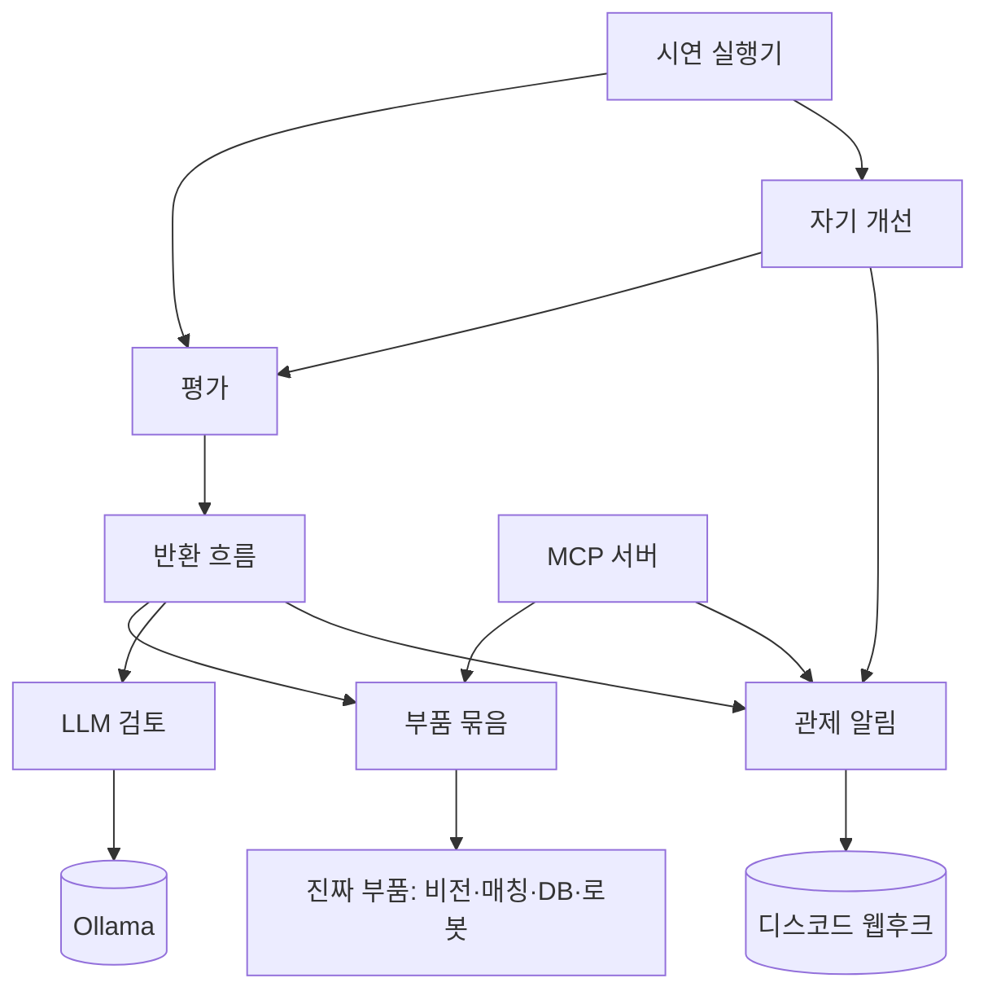

# ② 컴포넌트 — AI 관제탑

> "하지 않는 것"이 팀원 사이 일의 경계다. 의존은 위에서 아래 한 방향.

| 컴포넌트 | 위치 | 책임 | 하지 않는 것 | 의존하는 것 |
| --- | --- | --- | --- | --- |
| 반환 흐름(Supervisor) | agents/supervisor.py, agents/graph.py | 6단계 순서 진행, 안전 관문을 코드로 강제, 결정(반환·거절·직원 확인·정지) | 사진 분석·매칭 계산·로봇 제어·DB 저장 자체 | 부품 묶음, LLM 검토, 관제 알림 |
| 부품 묶음(Backend) | agents/tools.py (지금은 MockBackend) | 비전·매칭·DB·로봇 함수를 같은 이름으로 모아 흐름에 제공 | 안전 판단·순서 결정 | 진짜 부품(LF-3·8·11·19·20·21) |
| LLM 검토(Reviewer) | agents/llm_reviewer.py | 승인 직전 기록을 보고 "이상하면 보류"만 답함 | 승인·반환 결정, 개인정보 보기 | Ollama(로컬 Qwen3-VL-4B instruct) |
| 관제 알림(Reporter) | discord_ops/reporter.py, tools/notify.py | 채널 3곳 전송, 개인정보 모양 차단 | 흐름 멈추기·재시도 | 디스코드 웹후크(.env) |
| 평가(Evaluator) | evaluation/scoring.py, run_cases.py, eval_vision.py, answer_key.py | 고정 채점기로 점수·안전 위반 계산, 정답지 검사 | 설정 바꾸기·채택 결정 | 반환 흐름, 정답지 |
| 자기 개선(Improver) | evaluation/improve_loop.py | 개선안 제안 → 검증 비교 → 채택 판정(코드) → 기록 | 채점 방식 바꾸기, 최종 시험용 정답지 보기 | 평가, 관제 알림 |
| MCP 서버 | agents/mcp_server.py | 읽기·비교·알림 도구만 MCP로 공개 | 로봇·상태 변경 도구 공개 | 부품 묶음, 관제 알림 |
| 시연 실행기 | tools/tower_demo.py (+ 2조 봇) | 사례 10건 + 개선 회차를 한 번에 돌려 2000자 요약 | 코드 수정·push | 평가, 자기 개선, 관제 알림 |
| 공용 약속·설정 | agents/contracts.py, tools/envfile.py | 상수·검증 함수, .env 읽기 | 비밀값 출력·커밋 | 없음 |

- 순환 의존: 없음. 공용 약속·설정은 모든 컴포넌트가 읽기만 한다(그림에서 생략)

## 유스케이스 커버리지
| UC | 담당 컴포넌트 |
| --- | --- |
| UC-1 반환 처리 | 반환 흐름(주), 부품 묶음, LLM 검토, 관제 알림 |
| UC-2 관제 알림 | 관제 알림 |
| UC-3 시험 채점 | 평가, 반환 흐름 |
| UC-4 자기 개선 | 자기 개선, 평가, 관제 알림 |
| UC-5 디스코드 시연 | 시연 실행기(+ 2조 봇 세션, 저장소 밖 C:\git\discord-lab) |
| UC-6 MCP | MCP 서버, 부품 묶음 |
