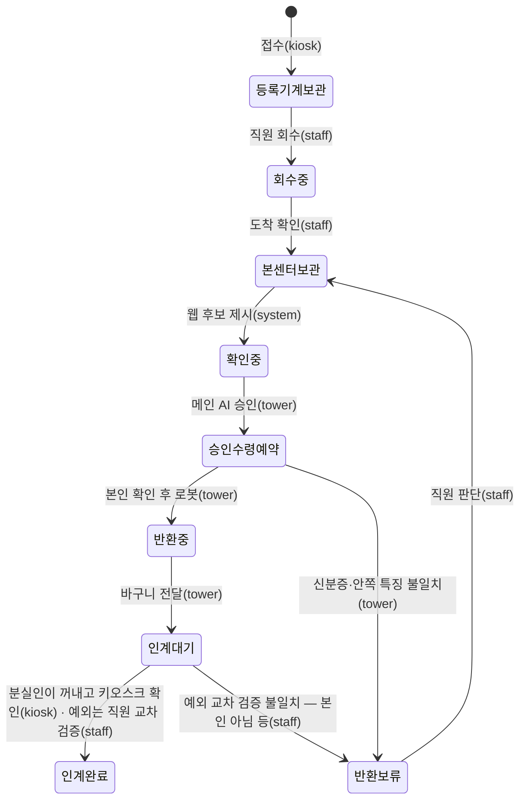

# DB 설계 v1 — PostgreSQL (11/3 확정)

> 설계·확정: 변재원(전체 구조 담당, 11/3). 표 정의 원본: `center/schema.sql` · 이미 만든 DB 에 바뀐 점 적용: `center/migrations/` (이미지 검색 `center/schema_vector.sql` 은 MVP 에서 쓰지 않음)
> 확인: PostgreSQL 16에서 두 번 실행 · 예시 데이터 입력 · 잘못된 값 거부(상태·결정·비공개 특징 위치·후보 순위·중복 번호·없는 물건) 검사 완료

## 0. 켜기·접속
- 켜기: 저장소 폴더에서 `docker compose up -d` → `lostfound-db` 컨테이너(포트 127.0.0.1:5434). 처음 켤 때 `center/schema.sql` → `center/seed_demo.sql`(시연 물건 A-W01~A-W07) 자동 실행
- 포트를 5434 로 둔 이유: 교육원 PC에는 수업용 Windows PostgreSQL 18(서비스 postgresql-x64-18)이 5433 을 쓰고 있어, 5433 으로 열면 팀 DB 대신 그쪽에 접속돼 비밀번호 오류가 난다
- `.env`: `POSTGRES_PASSWORD=…` · `DATABASE_URL=postgresql://lostfound:…@127.0.0.1:5434/lostfound` (값은 공유·커밋하지 않음)
- 주소는 `localhost` 말고 `127.0.0.1` 로 쓴다: Windows 는 localhost 를 IPv6(::1)로 먼저 시도하는데 팀 DB 는 127.0.0.1 에만 열려 있어 접속마다 5초씩 늦어진다(11/3 측정: 기록 조회 5초, 반환 1건 20초)
- 접속 확인: `python tools/check_ai_env.py` → "팀 DB(PostgreSQL): 127.0.0.1:5434 접속됨 · PostgreSQL 16 · 물건 7개" 면 정상(다른 PostgreSQL 에 붙으면 버전으로 알려 줌)
- 바뀐 점 적용: `python tools/db_migrate.py`(미리보기) → `--apply`. 관제탑을 켤 때(`tools\start_tower.bat`) 자동 적용된다
- 시연 뒤 물건 상태 되돌리기(데이터는 남김): `python tools/reset_demo.py` → 바뀔 목록 확인 → `python tools/reset_demo.py --apply`
- 표를 처음부터 다시 만들기(데이터 삭제): `docker compose down -v` → `docker compose up -d` (되돌릴 수 없음)
- 관제탑 쪽 코드: 물건 읽기·상태 변경 `agents/db_part.py`, 반환 기록 `agents/records.py` PostgresRecorder

## 1. 원칙
1. **한 DB, 표마다 주인**: 등록기계·회수·웹·관제탑 기록을 PostgreSQL 하나에 두고, 표마다 누가 쓰는지 정한다
2. **개인정보 최소**: 주민등록번호 칸 없음. 분실인 신분 정보는 **가린 값만**(예: 변\*원). 습득자 연락처는 **별도 표**로 떼어 직원만 열람
3. **비공개 특징 분리**: 확인 질문 정답인 `mark`·`visible_text` 는 `private_features` 칸에만(공개 칸에 섞이면 DB가 거부)
4. **값 목록은 코드와 같게**: 상태·결정 목록은 `agents/contracts.py` 와 같아야 하고, 시험이 이를 확인한다
5. **사진은 DB 밖**: 파일로 저장하고 위치만 기록. 이미지 비슷함 검색(pgvector)은 MVP 에서 쓰지 않는다(6장)

## 2. 표 관계

## 3. 표 목록
| 묶음 | 표 | 무엇 | 주인(쓰기) | 개인정보 |
| --- | --- | --- | --- | --- |
| 기준 | machine | 등록기계·본센터(호선·역·가상 여부) | 변재원 LF-8 | 없음 |
| 기준 | place | 습득 장소 추천 목록(같은 호선·자주 나온 순) | 김재민(화면)·변재원(DB) | 없음 |
| 접수 | item | 물건 1개 = 접수 1건(장소·시각·상태·품목·특징 JSON·사진 위치) | 변재원 LF-8(등록기계 화면·비전이 씀), 관제탑은 읽기·상태 변경 | 없음 |
| 접수 | finder_contact | 습득자 이름·전화(입력했을 때만, 인계 완료 30일 뒤 삭제) | 변재원 LF-8 | **있음 — 직원만** |
| 접수 | item_status_log | 상태가 바뀐 기록(누가: kiosk·staff·tower·system) | 상태를 바꾼 쪽 | 없음 |
| 회수 | collection / collection_item | 등록기계에서 꺼냄 → 본센터 도착, 빠진 물건 확인 | 변재원 LF-8 | 없음 |
| 찾기 | claim | 분실인 찾기 요청(동의 시각·가린 이름·가린 번호·설명 JSON·잃어버린 호선·역·날짜) | 김재민(화면)·정연우(설명 구조화 LF-5) | 가린 값만 |
| 찾기 | claim_candidate | 후보 1·2·3과 점수(점수는 내부용) | 김건태(매칭)·김재민 | 없음 |
| 찾기 | quiz_attempt | 확인 질문 시도(어느 특징을 물었는지·맞았는지만, 답은 저장 안 함) | 김재민 | 없음 |
| 찾기 | reservation | 수령 예약(방문 날짜·상태) | 김재민 | 없음 |
| 보관 | storage_section / storage_slot / storage_assignment / inventory_check | 본센터 보관함 정답지: 4행×2칸 + 인계 구역, 칸별 저장 자세, 물건 보관 위치(칸 하나에 물건 하나), 탑뷰 개수 확인 기록 — 11/6 `007_storage_slots_1106.sql`, 안내 `docs/design/storage_slots.md` | 변재원 LF-8(직원·관제탑), 저장 자세는 로봇 티칭 결과 | 없음 |
| 반환 | return_case / return_step | 반환 결정·이유·단계(관제탑 API가 저장) | **관제탑** | 없음 |
| 통계 | stats_item · stats_return (보기) | Text2SQL 통계 질문용 읽기 전용 | 정연우 LF-9 | 없음 |

## 4. 상태 흐름 (item.status)

- 그림의 이름은 띄어쓰기를 뺐다. 실제 값: `등록기계 보관 · 회수 중 · 본센터 보관 · 확인 중 · 승인·수령 예약 · 반환 중 · 인계 대기 · 인계 완료 · 반환 보류`
- 동작마다 어느 표가 어떻게 바뀌는지(11/10 시험용 DB 에서 한 바퀴 확인, DBeaver 조회문·Langfuse 와의 차이 포함): [db_change_flow.md](db_change_flow.md)

## 5. 관제탑 도구와 표 연결
| 도구·API | 읽는 표 | 쓰는 표 |
| --- | --- | --- |
| `db_get_item(item_id)` | item(공개+비공개 특징) | — |
| `db_set_status(item_id, status)` | item | item.status · item_status_log(changed_by=tower) |
| MCP `db_get_item` | item(공개 특징만) | — |
| 관제탑 API `POST /returns` | — | return_case · return_step |

## 6. 확정 사항 (11/3, 변재원)
| 항목 | 결정 | 어디에 반영 |
| --- | --- | --- |
| 접수 번호 형식 | `등록기계 문자-날짜-하루 순번 4자리`, 예 `A-20261103-0001`. 문자: KIOSK-A(중앙)=A, KIOSK-C(초량)=S, 본센터(부산역) 직접 접수=H. 시연 물건 `A-W01`~`A-W07` 도 허용 | DB 검사 `item_id_format`, `contracts.ITEM_ID_PATTERN`·`make_item_id()` |
| 찾기 번호 형식 | `C-날짜-순번`, 예 `C-20261103-0001` | DB 검사 `claim_id_format`, `contracts.CLAIM_ID_PATTERN` |
| 습득자 연락처 보관 | 물건이 **인계 완료된 뒤 30일**이 지나면 지운다(그 사이 반환 보류 등으로 상태가 바뀌면 남김). 이름·전화는 화면·로그에 찍지 않는다 | `tools/purge_contacts.py`(관제탑 켤 때 자동 실행), `contracts.CONTACT_RETENTION_DAYS` |
| 분실인 설명 칸 | 접수 특징과 **같은 칸 이름**: `category · color · shape · mark · visible_text · material`. 다른 칸이 들어오면 DB가 거부 | DB 검사 `claim_description_keys`, `contracts.DESCRIPTION_FIELDS`·`validate_description()` |
| 이미지 임베딩 | **MVP(지갑 1종)에서는 쓰지 않음** — 특징 JSON 매칭으로 충분. 품목이 늘면 비전 담당과 모델을 정한 뒤 `schema_vector.sql` 실행 | `center/schema_vector.sql` 머리말 |
| 텍스트 임베딩(11/3 추가) | 분실인 말 ↔ 물건 특징 문장 비교에 **다국어 텍스트 임베딩을 쓴다**(CPU). 물건 쪽은 등록 때 계산해 저장. 모델·차원·저장 칸은 PC 실측 뒤 확정(TBD) | architecture.md 3-3, `tools/bench_embedding.py` |

- 시험 `tests/test_db_decisions.py` 가 DB 검사 글자와 `contracts.py` 값이 같은지 확인한다(한쪽만 바꾸면 자동 시험 실패)
- 확인: PostgreSQL 16 에서 새 DB(schema.sql)와 어제 만든 DB(+마이그레이션 2번 실행) 모두 검사 3개가 생기고, 잘못된 번호·모르는 설명 칸은 거부, 연락처는 30일 지난 인계 완료 물건만 지워짐
