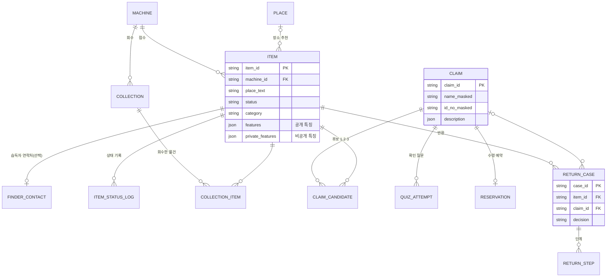
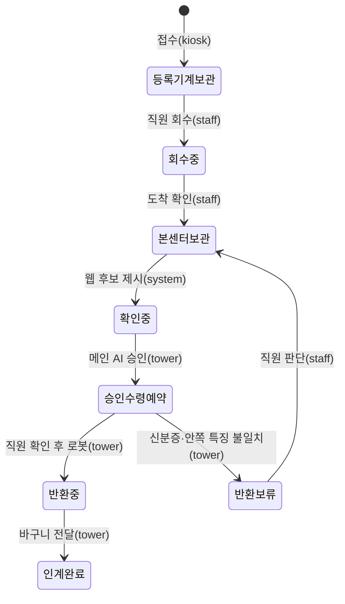

# DB 설계 초안 v1 — PostgreSQL (11/3)

> 설계: 변재원(전체 구조 담당) · 검토: 정연우(DB 담당 LF-8). 표 정의 원본: `center/schema.sql` (이미지 검색은 `center/schema_vector.sql`)
> 확인: PostgreSQL 16에서 두 번 실행 · 예시 데이터 입력 · 잘못된 값 거부(상태·결정·비공개 특징 위치·후보 순위·중복 번호·없는 물건) 검사 완료

## 0. 켜기·접속
- 켜기: 저장소 폴더에서 `docker compose up -d` → `lostfound-db` 컨테이너(포트 127.0.0.1:5434). 처음 켤 때 `center/schema.sql` → `center/seed_demo.sql`(시연 물건 A-W01~A-W07) 자동 실행
- 포트를 5434 로 둔 이유: 교육원 PC에는 수업용 Windows PostgreSQL 18(서비스 postgresql-x64-18)이 5433 을 쓰고 있어, 5433 으로 열면 팀 DB 대신 그쪽에 접속돼 비밀번호 오류가 난다
- `.env`: `POSTGRES_PASSWORD=…` · `DATABASE_URL=postgresql://lostfound:…@localhost:5434/lostfound` (값은 공유·커밋하지 않음)
- 표를 처음부터 다시 만들기(데이터 삭제): `docker compose down -v` → `docker compose up -d` (되돌릴 수 없음)
- 관제탑 쪽 코드: 물건 읽기·상태 변경 `agents/db_part.py`, 반환 기록 `agents/records.py` PostgresRecorder

## 1. 원칙
1. **한 DB, 표마다 주인**: 등록기계·회수·웹·관제탑 기록을 PostgreSQL 하나에 두고, 표마다 누가 쓰는지 정한다
2. **개인정보 최소**: 주민등록번호 칸 없음. 분실인 신분 정보는 **가린 값만**(예: 변\*원). 습득자 연락처는 **별도 표**로 떼어 직원만 열람
3. **비공개 특징 분리**: 확인 질문 정답인 `mark`·`visible_text` 는 `private_features` 칸에만(공개 칸에 섞이면 DB가 거부)
4. **값 목록은 코드와 같게**: 상태·결정 목록은 `agents/contracts.py` 와 같아야 하고, 시험이 이를 확인한다
5. **사진은 DB 밖**: 파일로 저장하고 위치만 기록. 이미지 비슷함 검색(pgvector)은 임베딩 모델이 정해지면 추가

## 2. 표 관계

## 3. 표 목록
| 묶음 | 표 | 무엇 | 주인(쓰기) | 개인정보 |
| --- | --- | --- | --- | --- |
| 기준 | machine | 등록기계·본센터(호선·역·가상 여부) | 정연우 | 없음 |
| 기준 | place | 습득 장소 추천 목록(같은 호선·자주 나온 순) | 김재민·정연우 | 없음 |
| 접수 | item | 물건 1개 = 접수 1건(장소·시각·상태·품목·특징 JSON·사진 위치) | 정연우(등록기계 화면·비전이 씀), 관제탑은 읽기·상태 변경 | 없음 |
| 접수 | finder_contact | 습득자 이름·전화(입력했을 때만) | 정연우 | **있음 — 직원만** |
| 접수 | item_status_log | 상태가 바뀐 기록(누가: kiosk·staff·tower·system) | 상태를 바꾼 쪽 | 없음 |
| 회수 | collection / collection_item | 등록기계에서 꺼냄 → 본센터 도착, 빠진 물건 확인 | 정연우 | 없음 |
| 찾기 | claim | 분실인 찾기 요청(동의 시각·가린 이름·가린 번호·설명 JSON·잃어버린 호선·역·날짜) | 김재민·정연우 | 가린 값만 |
| 찾기 | claim_candidate | 후보 1·2·3과 점수(점수는 내부용) | 김건태(매칭)·김재민 | 없음 |
| 찾기 | quiz_attempt | 확인 질문 시도(어느 특징을 물었는지·맞았는지만, 답은 저장 안 함) | 김재민 | 없음 |
| 찾기 | reservation | 수령 예약(방문 날짜·상태) | 김재민 | 없음 |
| 반환 | return_case / return_step | 반환 결정·이유·단계(관제탑 API가 저장) | **관제탑** | 없음 |
| 통계 | stats_item · stats_return (보기) | Text2SQL 통계 질문용 읽기 전용 | 정연우 LF-9 | 없음 |

## 4. 상태 흐름 (item.status)

- 그림의 이름은 띄어쓰기를 뺐다. 실제 값: `등록기계 보관 · 회수 중 · 본센터 보관 · 확인 중 · 승인·수령 예약 · 반환 중 · 인계 완료 · 반환 보류`

## 5. 관제탑 도구와 표 연결
| 도구·API | 읽는 표 | 쓰는 표 |
| --- | --- | --- |
| `db_get_item(item_id)` | item(공개+비공개 특징) | — |
| `db_set_status(item_id, status)` | item | item.status · item_status_log(changed_by=tower) |
| MCP `db_get_item` | item(공개 특징만) | — |
| 관제탑 API `POST /returns` | — | return_case · return_step |

## 6. 정연우 님께 확인받을 것 (TBD)
- 접수 번호 형식(`A-20261103-0001` 제안: 등록기계 문자-날짜-순번)
- 습득자 연락처 보관 기간(예: 반환 완료 후 N일 뒤 삭제) — 개인정보 처리 방침과 같이
- 설명 JSON(claim.description)을 접수 특징 JSON과 같은 칸 이름으로 맞출지(매칭에 유리)
- 임베딩 모델·차원(schema_vector.sql 의 512는 자리표시)
