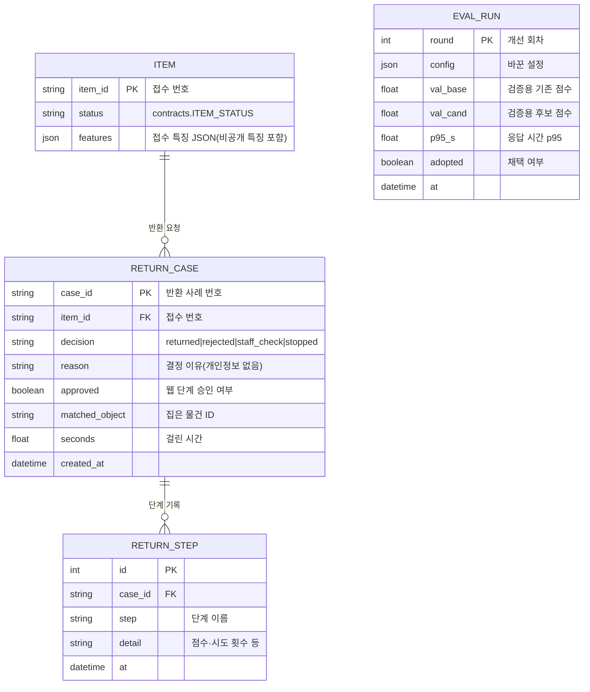

# ⑤ ERD — 관제탑이 남길 기록

> 물건 표(ITEM)는 DB 담당(정연우 LF-8)의 것이고, 관제탑은 **읽기 + 상태 변경**만 한다.
> RETURN_CASE · RETURN_STEP 은 **관제탑 소유로 확정(11/3)** — 표 정의 agents/schema.sql, 저장 agents/records.py(지금은 메모리, DB 연결 때 PostgreSQL). EVAL_RUN 은 아직 제안.

## 칼럼 출처
| 표.칼럼 | 근거(유스케이스·인터페이스 문장) |
| --- | --- |
| ITEM.item_id · status · features | UC-1 사전조건 "본센터 보관 상태, 접수 특징 JSON" / db_get_item 반환 |
| RETURN_CASE.decision · reason · approved | interfaces: Outcome.decision · reason · approved |
| RETURN_CASE.matched_object | UC-3 예외 ① "다른 물건을 집으면 wrong_object" — 무엇을 집었는지 남아야 확인 가능 |
| RETURN_CASE.seconds | Outcome.seconds |
| RETURN_STEP.step · detail | UC-2 기본 흐름 "단계 끝 → 진행 알림"(지금은 디스코드 글로만 남음) |
| EVAL_RUN.* | UC-4 기본 흐름 "채택 판정 → 기록"(지금은 #평가-점수 글로만 남음) |
| (없음) 개인정보 칼럼 | UC-2 예외 ① — 관제탑 기록에는 이름·전화·신분증 값을 두지 않는다 |
