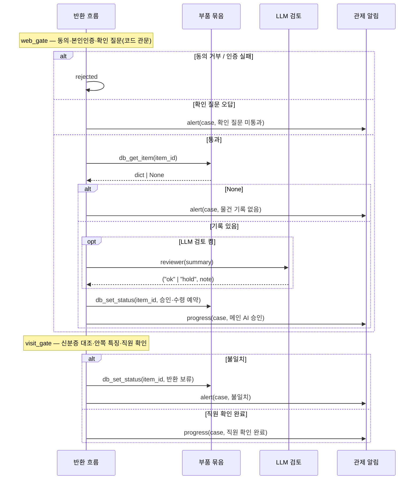
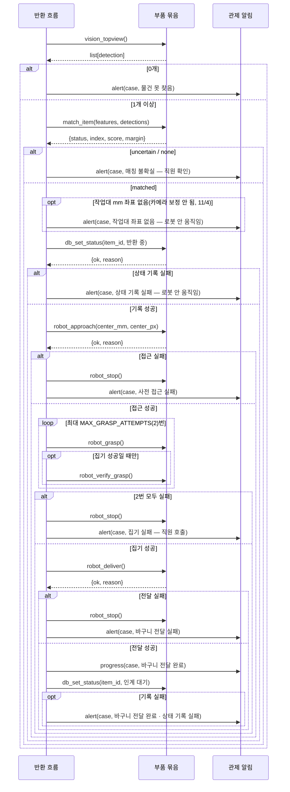

# ④ 시퀀스 — 반환 흐름(UC-1) 호출 순서

> participant 이름은 components.md, 화살표 라벨은 interfaces.md 의 함수 이름 그대로. 코드: agents/supervisor.py

## 정상 흐름 + 웹·방문 관문

## 로봇 반환 (locate → approach → grasp → deliver)

- 그림은 코드가 하는 일 그대로다(11/3 review 1·2·7 반영). `robot_stop()` 이 실패하면 알림 문구에 "정지 실패 — 직원 즉시 호출"이 붙는다
- 승인 단계의 `db_set_status(승인·수령 예약)` 도 실패하면 직원 확인으로 끝난다
